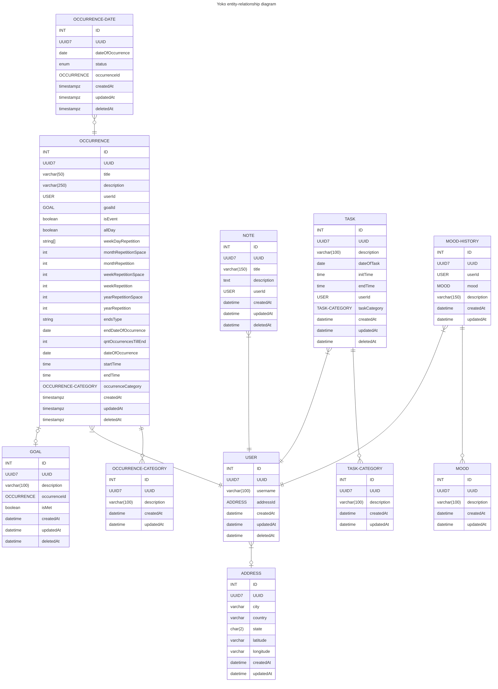

# Data model

The structure of Yoko's data, for both the database (PostgreSQL) and the back-end. The conventions behind it (id + UUID, `text` with CHECK, lookup tables) are in [decision 003](../decisions/003-database-conventions.md).

## Notes

- `deletedAt` marks a soft delete. Occurrences, tasks and notes stay in the history for tracking, as the [product requirements](../product/requirements.md) ask.
- `ADDRESS` only exists to find the user's coordinates when they don't share their location. See [decision 004](../decisions/004-period-of-the-day.md).
- How users are stored depends on the authentication provider, which is still open in #144.
