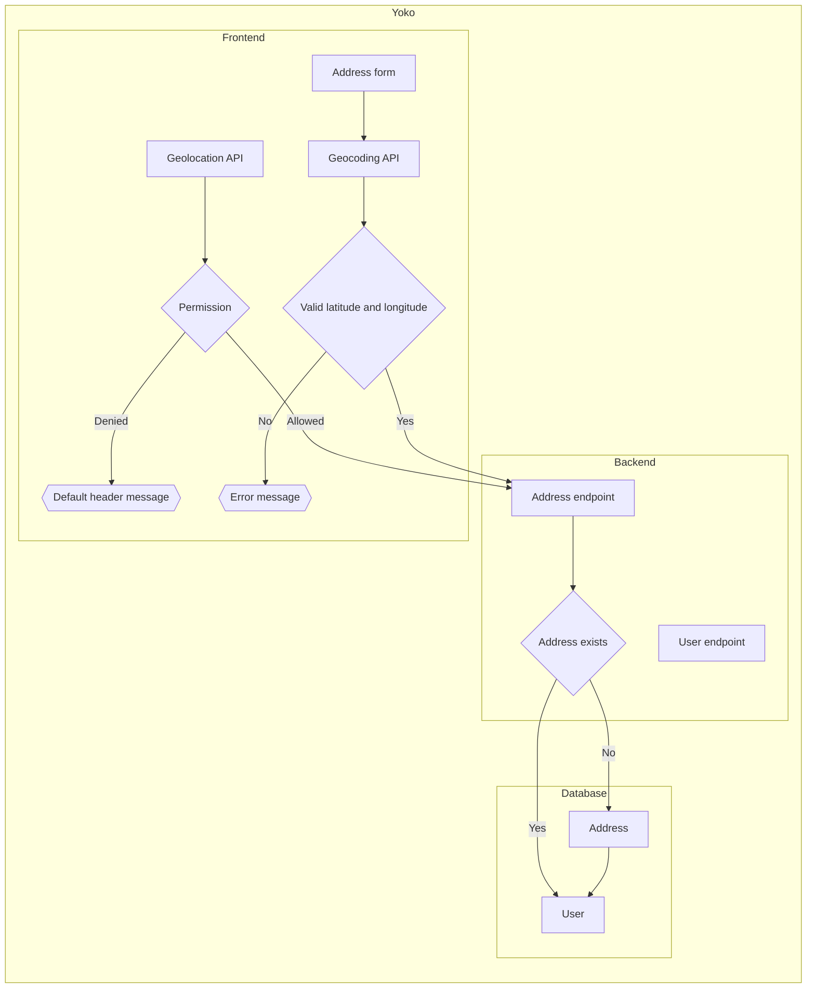

# 004 · Period of the day

- **Date:** 2026-10-31
- **Origin:** design notes made before the repository, brought in by #145
- **Status:** accepted

## Question

How does Yoko know the period of the day (sunrise, morning, sunset, night…) to greet the user, and what happens when it can't know the user's location?

## Short answer

- [SunCalc](https://github.com/mourner/suncalc) calculates sunrise and sunset. It is tiny and has no dependencies.
- SunCalc needs latitude and longitude. They come from, in this order:
  1. the browser's Geolocation API, with the user's permission;
  2. the address the user registers in the account settings (country, state and city), geocoded once with a geocoding API. The coordinates are stored and reused;
  3. nothing: the header shows the default message, which doesn't depend on the period of the day.
- The messages for each period are in the [product requirements](../product/requirements.md#greeting-by-period-of-the-day).

## Flow

## Consequences

- The user's coordinates are personal data. They are only stored with consent, and never appear in logs, examples or screenshots (see [decision 001](001-documentation-strategy.md)).
- The geocoding API key can't live in the browser, so geocoding runs on the back-end. Where that runs depends on #144.
